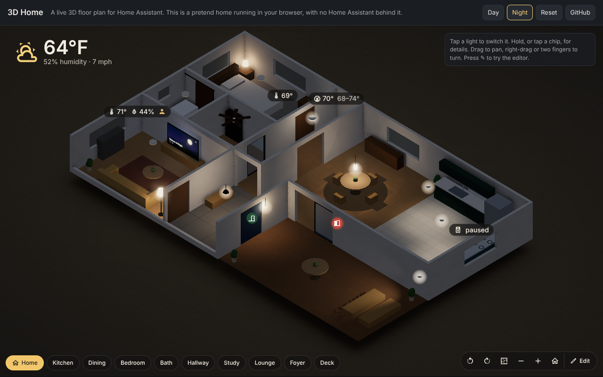

# 3D Home

A live **3D map of your home** for Home Assistant, on its own page in the sidebar, with an editor built in.

**[Try the demo](https://tbell19.github.io/ha-3dhome/)**: a pretend home running in your browser, with no Home Assistant behind it.



Lights glow in their real colour and brightness. Door sensors, climate and presence show up as chips anchored in 3D. Media players can appear as TVs that show the album art or show artwork. Tapping a light toggles it; holding opens its details. Admins can switch into **edit mode** to draw walls, move furniture and entities, drop in any Home Assistant entity, or place furniture models from the free Sweet Home 3D libraries.

The `ha_3dhome` integration adds a **3D Home page to the sidebar**, next to Map and Energy. The map is saved by the integration, and a save shows up straight away on every other screen that has it open. (Up to 5.x there was also a Lovelace card and a dashboard strategy; 6.0 keeps only the page, and the page can copy a map over from one of those dashboards.)

> **Status:** not released yet. The first release will be announced here; until then, HACS has nothing to install.

## Installing

### HACS (recommended)

1. In HACS, open the ⋮ menu → **Custom repositories**, add `https://github.com/tbell19/ha-3dhome` with type **Integration**.
2. Find **3D Home**, download it and restart Home Assistant.
3. Go to Settings → Devices & services → **Add integration** → **3D Home**. Choose the sidebar title and icon, who may open it and its address (`/3d-home` by default).

A **3D Home** page now shows in the sidebar. You can add more than one (a holiday home, say); each keeps its own map. Change a page's title, icon or access later under the integration's **Configure**.

The first time a page shows your map it asks whether Home Assistant should open on it. Later, change that with **Open Home Assistant here** in the map's **⋮** menu. It applies to your user on every device, like the dashboard choice on your profile page (which then shows 3D Home).

If you installed 3D Home earlier as a HACS **Dashboard**, remove that download and its resource.

Updates show up in HACS when a new release is published (restart afterwards). Turn on **Show beta versions** for the repository to get pre-releases.

### Manual

Copy the `ha_3dhome` folder from `ha_3dhome.zip` in the [latest release](https://github.com/tbell19/ha-3dhome/releases/latest) into `/config/custom_components/`, restart Home Assistant and add the integration as above.

### Your first map

**On the 3D Home page:** it opens on an empty map. Press **✎ Edit**, then **Floor plan**, to draw your walls and rooms (an uploaded photo of your floor plan works as a tracing image), then add your lights and sensors from the Add panel and **Save**.

**Already have a map on a dashboard?** Maps made with the 5.x card or dashboard (`custom:ha-3dhome-card`, `custom:ha-3dhome`, or ha-iso-home's `custom:iso-home-3d-card` and `custom:iso-home`) still exist in those dashboards, but 6.0 no longer draws them there. An empty 3D Home page looks through your dashboards and offers to copy the map from any that have one, bringing it up to date on the way. The dashboard itself is left as it is; delete it in Settings → Dashboards once you don't need it.

[examples/sample-home.json](examples/sample-home.json) is the demo's home, as an example of the map format ([docs/CONFIG.md](docs/CONFIG.md)).

Optional: add the **Downloader** integration with download directory `www`, so the editor can fetch the Sweet Home 3D furniture libraries.

## Features

**Viewing**
- Orthographic 3D floor plan with live lighting (spot lights for aimed track heads), static shadows, and a day/night look that follows `sun.sun`.
- Map-style camera controls:
  - Mouse: drag to pan, right-drag to orbit, wheel zooms to the cursor.
  - Touch: one finger pans, two fingers pinch and twist.
  - Buttons: rotate 90°, top-down plan view, zoom, home.
- Room menu: tap a room, or double-click its floor, and the camera flies there and frames it.
- Live chips: temperature, humidity, occupancy, climate, door state, weather, and any entity as an icon + state badge.

**Editing** (admins only)
- **Moving things:** drag any piece or marker along the floor. Furniture is grouped, so the sofa moves as one. Lights follow their fixtures.
- **Rotating:** snap-rotate, or drag around a piece in Rotate mode.
- **Commands:** duplicate, delete, group/ungroup, undo/redo. Keyboard: arrows nudge, Q/E rotate, Del deletes, Ctrl+Z undoes.
- **Add panel:** every HA entity is searchable and draggable onto the map. **Show as** switches between light glow, badge, door marker, invisible tap spot, or **screen** (media players and cameras).
- **Sweet Home 3D libraries:** downloaded once into `/config/www/sh3d/` by the Downloader integration, then browsed and placed on the map.
- **Phones:** compact UI. One finger only moves things that are already selected, and two fingers always control the camera.
- **Floor plan mode:**
  - Draw and reshape walls by dragging corners; they snap to corners, walls and 15° angles.
  - Click a wall to cut in a door or window. These are negative boxes that cut any wall they pass through.
  - Trace over an uploaded **blueprint image** after setting its scale from a known length.
  - Lengths show in feet and inches or metric.
- **Saving:** on the 3D Home page, Save stores the map in the integration and every other open screen picks it up. If someone saved from another device while you were editing, Save says so instead of overwriting their work.

## Development

```bash
npm install                 # three, jszip, preact, terser, playwright (uses the system Chromium if present)
npm test                    # desktop smoke test  -> tools/out/*.png
npm run test:mobile         # phone viewport + touch gestures
npm run build               # custom_components/ha_3dhome/frontend/*.js + size report
npm run test:plan           # floor plan editor: drawing, doors/windows, joints, blueprint + scale
npm run test:panel          # the sidebar page: import, saving, saves from other devices, edit clashes
npm run typecheck           # TypeScript, strict where the code allows
npm run test:py             # the integration (pip install -r requirements_test.txt first)
npm run test:leaks          # GPU/heap/WebGL-context growth over 3000 updates, edits, plan rebuilds, config churn
npm run demo                # serve the standalone demo (site/) at http://localhost:8080
npm run test:demo           # check the demo works with no Home Assistant
```

The tests render with software WebGL, so a run takes a minute or two. How versions reach users: [docs/RELEASING.md](docs/RELEASING.md).

## Docs

- [docs/CONFIG.md](docs/CONFIG.md): every config option and the scene schema
- [docs/EDITOR.md](docs/EDITOR.md): using the editor (desktop and phone)
- [docs/ARCHITECTURE.md](docs/ARCHITECTURE.md): how the code is organised, coordinate system, rendering, editor internals
- [docs/RELEASING.md](docs/RELEASING.md): versions, tags, releases and the demo site
- [docs/HISTORY.md](docs/HISTORY.md): how the project evolved, decisions, open items

## Credits

- Furniture models come from the [Sweet Home 3D libraries](https://www.sweethome3d.com/import-models/) (Free Art License, CC-BY or CC0, depending on the library). Per-model author and licence are stored with each placed model and shown in the editor.
- 3D rendering by [Three.js](https://threejs.org/); zip parsing by [JSZip](https://stuk.github.io/jszip/); the editor's panels by [Preact](https://preactjs.com/).
